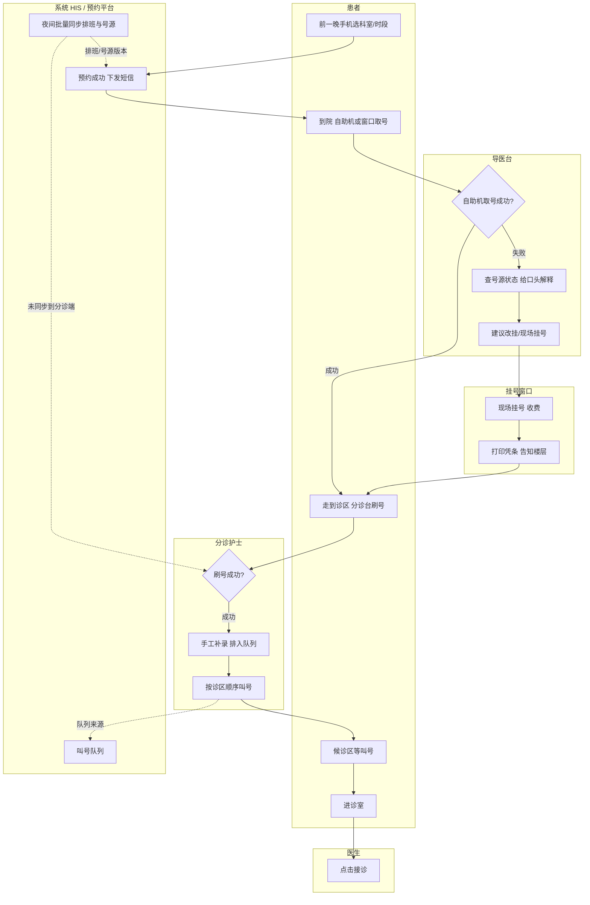
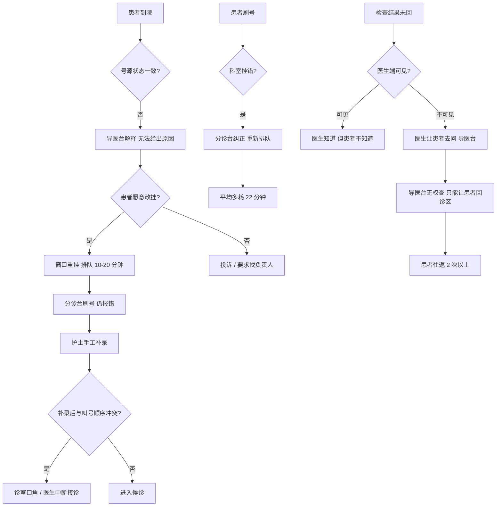

# 现状流程图 · 门诊预约与分诊协作

> 依据：`docs/02-调研记录.md` 的 36 条访谈记录 + 现场观察 42 单（2026-10-08 — 10-28）
> 画不出来的地方，就是访谈还有缺口 —— 已在下文「未闭合处」标出，不自己猜。

---

## 一、主流程泳道图（正常一单）

**读图要点**

- `B1`、`D1` 是**判断点**（决定走哪条路），`B2`、`C1`、`D2` 是**执行点**（实际动手）。后面智能体分工就按这个切：判断点可以给建议，执行点必须留人。
- `S2` 那条虚线是整个流程的病根：**夜间批量同步**，同步窗口内患者端与院内端天然不一致。
- 正常一单经过 **6 个角色、11 个动作、3 次排队**（自助机、窗口、分诊台）。"预约了还要排三次队"不是患者感受问题，是流程结构问题。

---

## 二、异常分支（这三条才是真实现场）

| 异常 | 触发条件 | 现场处置 | 留痕情况 |
|---|---|---|---|
| 号源不一致 | 夜间同步窗口内、或跨院区排班 | 导医口头解释 → 窗口重挂 → 护士补录 | **无系统留痕**，只有手写登记本 |
| 错挂科 | 患者自选科室、症状描述不清 | 分诊台改科室、重新排队 | 手工计数，无原因字段 |
| 过号 | 患者离开候诊区、未听见叫号 | 制度写「顺延 3 位」，实际多数要求重新排队 | 两套做法并存，无仲裁记录 |
| 结果未回 | 检验/影像未回写 | 医生让患者去导医台问，导医台无权查 | 无工单，无责任人 |
| 加号 | 医生临时加号 | 一部分系统内加，一部分手写条子 | 留痕率约 40%（`待核实`） |

---

## 三、瓶颈定位（按等待时间排序，来自现场观察 42 单）

| 排序 | 环节 | 平均耗时 | 占比 | 是否可被系统改善 |
|---|---|---|---|---|
| 1 | 号源不一致排查与重排 | 38 分钟（最长 55） | 主要瓶颈 | 可（同步机制 + 状态一致性校验） |
| 2 | 窗口现场挂号排队 | 14 分钟 | 次要 | 部分（分流 + 预检提示） |
| 3 | 分诊台刷号/补录 | 6 分钟 | 次要 | 可（分诊端可见号源归属） |
| 4 | 错挂科纠正 | 22 分钟（发生时才计） | 偶发但痛感强 | 可（症状预检 + 科室建议，但必须人工确认） |
| 5 | 结果未回往返 | 18 分钟（发生时才计） | 偶发 | 可（结果状态对患者可见） |

---

## 四、未闭合处（访谈缺口，必须回访，不许猜）

| 编号 | 缺口 | 影响 | 回访对象 |
|---|---|---|---|
| G-01 | 夜间同步任务的具体时间窗与失败重试策略 | 决定"到院前拦截"是否可行 | 信息科 张涛 |
| G-02 | 跨院区排班由谁维护、冲突时以哪边为准 | 决定号源归属规则 | 门诊部 陈国华 |
| G-03 | 过号"顺延 3 位"的成文依据与例外审批 | 决定过号处置能否标准化 | 医务科 赵敏 |
| G-04 | 加号纸质条子的实际流向（谁收、谁核） | 决定留痕改造的落点 | 导医 李静 |

> 这 4 条不闭合，阶段 03 写的需求里「号源一致性」「过号处置」两条就没有验收依据。
